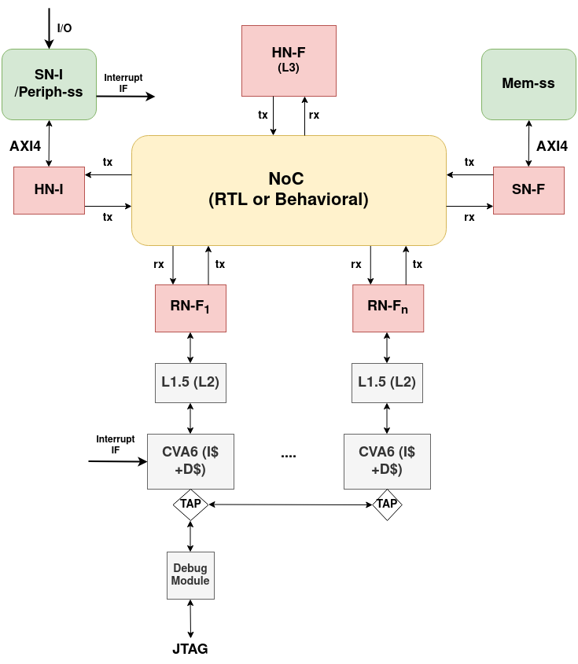

# System Overview


# Testbenches

Three top-level testbenches exist. The two that need a second simulation
kernel (gem5 or SystemC) live in `cosim/`:

| File | Description |
|------|-------------|
| `riscv_rnf_hnf_tb.sv` | Original standalone TB — behavioral RTL HNF + SNF, no gem5 |
| `cosim/riscv_rnf_gem5_tb.sv` | gem5 co-simulation TB — replaces HNF with gem5 IPC bridge |
| `cosim/tlm_rnf_hnf_tb.sv` | TLM packet-injector TB — two SystemC RN-Fs drive the RTL HN-F via behavioral ICN |

`riscv_rnf_hnf_tb.sv` and `cosim/riscv_rnf_gem5_tb.sv` instantiate `tb_chi_system` and share the same CHI ICN and RNF DUT.

`cosim/` also holds the SystemC RN-F bridge (`chi_tlm_rnf.{h,cpp}`), its
`sc_main` stub (`questa_sc_main.cpp`), the SV port stub
(`chi_tlm_rnf_sv_wrap.sv`), the TLM file list (`chi_tlm_flist`), and the
coverage bind for the gem5 TB (`rnf_coverage_gem5_bind.sv`).

---

## TLM RN-F TB (`tlm_rnf_hnf_tb.sv`)

A pure Questa SV+SC co-simulation testbench — no gem5, no IPC bridge, no RISC-V
core.  Two SystemC/TLM `chi_tlm_rnf` instances act as CHI packet injectors and
drive the RTL HN-F through the behavioral `chi_icn_beh` interconnect.

### Architecture

```
  ┌──────────────────────────────────────────────────┐
  │  Questa (tlm_rnf_hnf_tb.sv)                      │
  │                                                  │
  │  chi_tlm_rnf (u_rnf0, SC)  ──┐                  │
  │  chi_tlm_rnf (u_rnf1, SC)  ──┤                  │
  │                              ▼                   │
  │                       chi_icn_beh (SV)           │
  │                              │                   │
  │                              ▼                   │
  │                         hnf RTL (SV)             │
  │                              │                   │
  │                              ▼                   │
  │                       tb_snf / mem_ss (SV)       │
  └──────────────────────────────────────────────────┘
```

The SC modules are compiled with Questa's `sccom` and embedded in the Questa
work library via `sccom -link`.  vsim auto-discovers the shared library at
`questa_build/work/_sc/linux_x86_64_gcc-*/systemc.so` — no `-sclib` flag is
needed.

### Source files

| File | Description |
|------|-------------|
| `chi_tlm_rnf.h` | SC module declaration — CHI ports, transaction helpers |
| `chi_tlm_rnf.cpp` | SC implementation — link activation, REQ/DAT/RSP handling |
| `questa_sc_main.cpp` | Minimal `sc_main()` required by Questa's SC kernel |
| `tlm_rnf_hnf_tb.sv` | SV top-level — instantiates SC modules, ICN, HNF, SNF |
| `chi_icn_beh.sv` | Behavioral CHI interconnect — credit management, flit routing |
| `chi_tlm_flist` | vlog file list (HNF RTL + SNF + TB sources) |
| `Makefile` | Build rules (sc, sv, sim, wave targets) |

### Prerequisites

- Questa 2024.1 or later (provides `sccom`, `vlog`, `vsim`)
- A C++14-capable gcc (Questa's bundled gcc-10.3.0 is used automatically by
  `sccom`)

No gem5, no external libraries, and no RISC-V toolchain are required.

### Build and run

All commands run from the `cva6-RNF/tb/` directory.

```bash
cd /path/to/chi-rnf/cva6-RNF/tb

export QUESTA=/path/to/questa_24/questasim
```

**1 — Compile everything (SC model + RTL):**

```bash
make QUESTA=$QUESTA all
```

This runs two steps in order:

- `make sc` — compiles `chi_tlm_rnf.cpp` and `questa_sc_main.cpp` with
  `sccom`, then links them into
  `questa_build/work/_sc/linux_x86_64_gcc-10.3.0/systemc.so`.
- `make sv` — compiles all RTL and SV sources listed in `chi_tlm_flist` with
  `vlog`.

**2 — Run batch simulation:**

```bash
make QUESTA=$QUESTA sim
```

Runs `vsim -c work.tlm_rnf_hnf_tb -do "run -all; quit"`.  Expected output at
the end of a passing run (default verbosity):

```
[CHI_MON][RNF-0] DONE  t=... Op:25 WriteUniqueFull LineAddr:80000040 (Comp, no CompAck)
[CHI_MON][RNF-0] DONE  t=... Op:1  ReadClean      LineAddr:80000040 (CompData)
[CHI_MON][RNF-1] DONE  t=... Op:1  ReadClean      LineAddr:80000040 (CompData+Snoop)
[CHI_MON][RNF-1] DONE  t=... Op:11 CleanUnique     LineAddr:80000040 (Comp)
[CHI_MON][RNF-1] DONE  t=... Op:25 WriteUniqueFull LineAddr:80000040 (Comp, no CompAck)
[CHI_MON][RNF-1] DONE  t=... Op:1  ReadClean      LineAddr:80000040 (CompData)
```

**3 — Interactive simulation with waveforms:**

```bash
make QUESTA=$QUESTA wave
```

Opens the Questa GUI, logs all signals (`log -r /*`), runs the simulation to
completion, and zooms the wave window to the full simulation time.

**4 — Runtime debug flags:**

Extra verbosity is controlled via `SIMARGS` on the make command line.  The
flags can be combined freely:

| Flag | What it enables |
|------|-----------------|
| `+rnf_verbose` | Per-step trace from each SC RN-F (link activation, every REQ/DAT/RSP sent or received) |
| `+mon_verbosity+N` | Override `chi_monitor` verbosity at runtime: `0` = errors/deadlocks only, `1` = +completions (default), `2` = +per-flit trace |
| `+icn_debug` | Flit-level trace from the behavioral ICN (`chi_icn_beh`) — captured and forwarded flits on every channel |

Example — full trace:

```bash
make QUESTA=$QUESTA sim SIMARGS="+rnf_verbose +mon_verbosity+2 +icn_debug"
```

Example — quiet monitor with SC-level trace only:

```bash
make QUESTA=$QUESTA sim SIMARGS="+rnf_verbose +mon_verbosity+0"
```

**5 — Override the project root (optional):**

`PROJ_ROOT` defaults to `../..` (the repository root, parent of `cva6-RNF/`).
Override it if the repository is checked out under a different layout:

```bash
make QUESTA=$QUESTA PROJ_ROOT=/custom/path all
```

**6 — Clean build artifacts:**

```bash
make clean
```

Removes the entire `questa_build/` directory.

### Test sequence

Both SC RN-F instances wait 12 000 clock cycles after reset before issuing
any transaction.  The RTL HN-F pipeline requires approximately 10 000 cycles
to initialise; issuing requests before that causes the HNF to accept write
data (DBIDResp) but never send the final Comp.

Every transaction helper begins with a `tick(20)` inter-transaction gap so
the previous transaction's CompAck reaches the HN-F and its MSHR entry
retires before the next REQ is issued (CHI non-interleaving compliance).

Test addresses:
- `ADDR_A = 0x80000040`, `ADDR_B = 0x80000080`, `ADDR_C = 0x800000C0`
- `ADDR_D = 0x80000100`, `ADDR_E = 0x80000140`, `ADDR_F = 0x80000180`

Data buffers: `data_a` (0xAA..), `data_b` (0xBB..), `data_c` (0xCC..),
`data_d` (0xDD..), `data_e` (0xEE..), `data_f` (0x11..).

#### Phase 1 — Non-interleaved (single RN-F at a time)

**RNF0** runs Ph1–Ph15 + Ph_EV sequentially, then seeds ADDR_A/B in SC and
signals RNF1 via `g_rnf0_write_done`:

| Ph    | Coverage |
|-------|----------|
| Ph1   | `WriteUniqueFull` / `ReadClean` / `CleanUnique` / `WriteBackFull` |
| Ph2   | `ReadUnique` / `WriteBackFull` / `MakeUnique` |
| Ph3   | `ReadOnce` / `ReadNoSnp` / `ReadNotSharedDirty` |
| Ph4   | `WriteNoSnpFull` / `ReadNoSnp` |
| ~~Ph5~~  | ~~`WriteUniquePtl` first-32B~~ — **disabled** (partial-merge open issue) |
| Ph6   | `CleanShared` (dataless hint, UC→UC) |
| Ph7   | Multi-line burst on 3 disjoint lines (D/E/F) |
| ~~Ph8~~  | ~~`WriteUniquePtl` second-32B~~ — **disabled** |
| Ph9   | Three back-to-back `WriteUniqueFull` to same line — last-writer wins |
| Ph10  | `ReadOnce` / `ReadNoSnp` on a line locally cached in SC |
| Ph11  | `WriteNoSnpPtl` partial overwrite + verify byte-merge |
| Ph12  | `Evict` from UC, then re-fetch from memory |
| ~~Ph13~~ | ~~`WriteUniquePtl` middle bytes~~ — **disabled** |
| Ph14  | Triple `(I→SC→UC→I)` WriteBack cycle on one line |
| Ph15  | 6-line write burst followed by 6-line read burst (A..F) |
| Ph_EV | `Evict` from each legal source state: SC, UC, UCE |

**RNF1** waits for the signal, then runs Ph16–Ph19:

| Ph    | Coverage |
|-------|----------|
| Ph16  | Coherent `ReadClean` + `CleanUnique` on ADDR_A (RNF0 in SC) |
| Ph17  | Coherent `ReadUnique` + `WriteBackFull` on ADDR_B |
| Ph18  | `ReadOnce` + `ReadNoSnp` from RNF1 |
| Ph19  | `ReadClean` → `CleanUnique` → `Evict` → `ReadClean` chain |

After Ph19, RNF1 sets `g_rnf1_phases_done = true` so RNF0 leaves its
snoop-service loop and both join the interleaved phases.

#### Phase 2 — Interleaved (cross-RN-F barriers)

The two RN-Fs synchronize at a polled barrier (each side sets its own
`g_rnfX_at_ilN` flag and `tick()`s until the other side's flag is set; both
keep servicing snoops/responses while waiting).  After the barrier, both
RN-Fs run their halves concurrently — `tick(20)` inside every helper keeps
the first protocol REQ within a tight window of the other.

| IL    | Test |
|-------|------|
| IL1   | Concurrent `WriteUniqueFull` to *different* lines (E vs F) |
| IL2   | Concurrent `ReadClean` to *same* line (ADDR_D, read-read race) |
| IL3   | Concurrent `CleanUnique` to *same* line (ADDR_A, upgrade race) |
| IL4   | Concurrent `ReadUnique` to *same* line (ADDR_B, R4O race) |
| IL5   | Concurrent `WriteUniqueFull` to *same* line (ADDR_C, last-writer) |
| IL6   | Concurrent `ReadOnce` to *same* line (ADDR_D, no-coherence) |
| IL7   | `ReadClean` ↔ `WriteUniqueFull` on ADDR_E (mixed race) |
| IL8   | Cross-address burst (RNF0: A/B/C, RNF1: D/E/F) |
| IL9   | `WriteBackFull(UC)` ↔ `ReadClean` on ADDR_F |
| IL10  | Concurrent `WriteBackFull` on different lines (D vs E) |
| IL11  | Concurrent `CleanInvalid` to *same* line (ADDR_A) |
| IL12  | Concurrent `Evict` on different lines (B vs C) |
| IL13  | Pipelined 4-step (W/R/CU/CI) on disjoint lines |
| IL14  | Ping-pong UC ownership on ADDR_F (3 rounds each) |
| IL15  | Concurrent `MakeUnique` to *same* line (ADDR_A, UCE race) |
| IL16  | Producer (RNF0) / Consumer (RNF1) on ADDR_B, 4 iterations |
| IL17  | Concurrent `ReadClean` to disjoint lines (C vs D), 3 rounds |
| ~~IL18~~ | ~~Concurrent `WriteUniquePtl` on different lines~~ — **disabled** |
| IL19  | Ownership chain on ADDR_D — UC → snoop → re-acquire |

After IL19 both sides `tick(200)` for drain; RNF1 calls `sc_stop()`.

### Transaction helpers (chi_tlm_rnf.cpp)

All helpers are blocking; each starts with `tick(20)` and completes only
after Comp (and CompAck where required) is received.

| Helper | CHI opcode | Notes |
|--------|------------|-------|
| `do_read` | ReadClean (0x02) | ExpCompAck=1, ends in SC |
| `do_read_unique` | ReadUnique (0x07) | ExpCompAck=1, ends in UC |
| `do_read_not_shared_dirty` | ReadNotSharedDirty (0x26) | via `do_read_generic` |
| `do_read_once` | ReadOnce (0x03) | non-allocating |
| `do_read_no_snp` | ReadNoSnp (0x04) | DMT, non-coherent |
| `do_write` | WriteUniqueFull (0x19) | no ExpCompAck |
| `do_write_unique_ptl` | WriteUniquePtl (0x18) | byte-enable RMW — **unused** (test phases disabled, helper retained for future re-enable) |
| `do_write_back_full` | WriteBackFull (0x1b) | data taken from local cache |
| `do_write_no_snp_full` | WriteNoSnpFull (0x1d) | DWT-disabled (order=2/expcompack=1); inline CompAck |
| `do_write_no_snp_ptl` | WriteNoSnpPtl (0x1c) | DWT-disabled; inline CompAck |
| `do_clean_unique` | CleanUnique (0x0b) | SC→UC, sends CompAck |
| `do_clean_invalid` | CleanInvalid (0x09) | →I, no CompAck |
| `do_clean_shared` | CleanShared (0x08) | dataless hint, no state change |
| `do_make_unique` | MakeUnique (0x0c) | I→UCE, sends CompAck |
| `do_evict` | Evict (0x0d) | any→I, dataless evict hint |

### Rebuilding after SC source changes

`make` tracks dependencies: editing `chi_tlm_rnf.cpp` or `chi_tlm_rnf.h`
automatically triggers `make sc` on the next `make all`.  If the timestamps
are the same second (e.g. after a `git checkout`), force a rebuild with:

```bash
rm questa_build/.sc_done && make QUESTA=$QUESTA all
```

### Test-case generator (`testgen/`)

In addition to the hand-written Ph1–Ph19 / IL1–IL19 sequences above, the
TLM testbench supports an **FSM-driven test-case generator**. See
[`testgen/README.md`](testgen/README.md) for the full pipeline. Quick
summary:

| Stage | Tool | Notes |
|-------|------|-------|
| Model | [`testgen/murphi/hnf_fsm.m`](testgen/murphi/) | Murphi formal model — primary source of truth (symmetry-reduced, invariant-checked) |
| Generate | `gen_from_murphi.py --vectors` | One vector per reachable (state, REQ) target |
| Replay | `chi_tlm_rnf.cpp` (`#ifdef RNF_REPLAY_DEMO`) | Orchestrator/worker pair dispatches vectors via `do_*` helpers |
| Observe | `mshr_observer.sv` (bind) | `[MSHR_OBS]` trace lines |
| Score | `oracle.py` | Diffs observed MSHR ALLOCs vs vector's expected REQs |
| Batch | `run_murphi.sh` | Fresh-vsim-per-vector with coverage |

**Address-space partition (CHI E.b §2.4.2):** the coherent FSM models
only coherent ops on `ADDR_COHERENT = 0x80000200`. Non-coherent ops
(`ReadNoSnp`, `WriteNoSnp*`, `ReadOnce`) live in a separate subspace
(`ADDR_NONCOHERENT = 0xC0000200`).

**One-shot end-to-end run:**

```bash
make QUESTA=$QUESTA clean
make QUESTA=$QUESTA all REPLAY=1 MSHR_OBS=1 COVERAGE=1 HNF_ASSERT=1
QUESTA=$QUESTA ./testgen/run_murphi.sh
vcover merge -64 testgen/murphi_merged.ucdb \
    testgen/run_all_logs/murphi/*.ucdb
vcover report testgen/murphi_merged.ucdb
```

**Build flags:**

| Var | Effect |
|---|---|
| `REPLAY=1` | Replay path enabled (`-DRNF_REPLAY_DEMO`); reads `REPLAY_VECTOR` + `REPLAY_ADDR` env vars |
| `MSHR_OBS=1` | Adds `mshr_observer.sv` bind — required for the oracle |
| `COVERAGE=1` | Adds `+cover=bcsf` to vlog + Tier-1 observers (`mshr_coverage.sv`, `coherence_coverage.sv`) |
| `HNF_ASSERT=1` | Protocol `$fatal` checkers |
| `HNF_TRACE=1` | Very verbose per-flit traces |
| `ICN=behavioral\|mesh` | Interconnect: `chi_icn_beh.sv` (default) or OpenNoC 2×2 mesh via `chi_icn_mesh.sv` adapter |
| `SNF=tbsnf\|memss` | Memory: lightweight `tb_snf.v` (default) or full RTL `snf` + `axi2mem` + width-matched SRAM (`mem_ss.sv`) |

### Interconnect & memory swap-in

| Combo | Status |
|---|---|
| `ICN=behavioral SNF=tbsnf` | 166/166 PASS — baseline |
| `ICN=mesh       SNF=tbsnf` | 166/166 PASS — physical NoC verified |
| `ICN=behavioral SNF=memss` | 166/166 PASS — physical RTL SN-F verified |
| `ICN=mesh       SNF=memss` | known-bad: HNF MSHR stalls at `REQ_RCVD_HNF`. Likely chi_icn_mesh's initial-credit pulse to mem_ss races mem_ss's link-activate FSM. Both pieces work independently — wiring fix pending. |

**Mesh NID encoding** (`{X[2:0], Y[2:0], port}` per `chi_xp_channel.v` `route_xy`):
RNF0 = `7'h00`, RNF1 = `7'h01`, HNF = `7'h10` (X=1, Y=0), SNF = `7'h12` (X=1, Y=1).
HNF and SNF NIDs are overridden via `\`ifdef ICN_MESH` in `tlm_rnf_hnf_tb.sv`; SystemC
side is plumbed via `-DHNF_NID_DEFAULT=16` in `SCCOM_DEFS`.

**Wave debug:** `tb/mesh_long_wave.do` loads a 13-step Murphi vector trace with
struct-parsed flits for inspection. The mesh adapter (`chi_icn_mesh.sv`) exposes
`*_dbg` signals mirroring `chi_icn_beh`'s for parity.

**YAML-based legacy flow** (`gen_sequences.py`, `gen_burst.py`,
`gen_cross.py`, `fuzz_sequences.py`) is still present and produces
extra coverage axes (burst, address sweep, fuzz) that complement the
Murphi BFS sweep. See [`testgen/README.md`](testgen/README.md) for
details.

**Visualization:** `make testgen-murphi-dot` →
`testgen/murphi/hnf_fsm_murphi.dot` + PNG (symmetry-reduced + raw
variants).

### Potential improvements / known limitations

The current testgen pipeline is solid for edge / state / burst / cross
coverage of the modelled FSM, but a few axes are not exercised today:

- **Path-history diversity (BFS shortest-path bias).** All BFS vectors
  reach their target state via the *shortest* path, so many vectors
  share the same precursor chain (e.g. every `UC_A`-target vector
  reaches UC_A through `MakeUnique`, never through `ReadUnique`-from-
  another-RN-F). Bugs that depend on *how* the design got to a state —
  L3-directory residency, MSHR allocation history, snoop-filter way-
  selection — won't surface unless we also exercise alternative paths
  to the same state. A future `gen_diverse.py` (Yen's K-shortest paths
  + Jaccard-similarity scoring against already-chosen prefixes) would
  emit an *augmenting* vector set with maximally-different paths to
  each target, optionally running paired (shortest, diverse) variants
  back-to-back to detect path-history-dependent divergence.

- **CAM-hazard pending-state machinery (runtime gap).** The FSM models
  the pending-REQ machinery in full: when a second REQ arrives during a
  transient (`hnf_mshr_bypass.v:400`, `rxreq_cam_hazard_s1_q`), the FSM
  transitions to a composite state `<state>__PEND_<peer>_<op>` that
  carries both the in-flight transaction's progress AND the queued
  peer REQ. Mirrored completion edges keep the queued REQ alive until
  the in-flight transaction retires, at which point an `AUTO_START_*`
  event starts processing the queued REQ. 140 such pending states +
  412 edges are auto-generated by `make testgen-expand-hazards` (see
  `expand_hazards.py`). Hazard *entry* edges use event names suffixed
  `__HAZARD`, currently denylisted from vector generation because
  exercising them in sim requires the RN-F driver to handle `RetryAck`
  and the subsequent `PCrdGrant` re-issue handshake — neither of which
  `chi_tlm_rnf` implements yet. To enable end-to-end exercise: drop
  the `__HAZARD` filter in `gen_sequences.py`, add retry handling to
  `do_read_generic()` / `do_write*()`, and have the orchestrator
  inject overlapping REQs via FORK/JOIN.

- **Same-SrcID MSHR pipelining.** Each RN-F has at most one outstanding
  transaction (the `do_*()` helpers block on Comp+CompAck). Cross-RN-F
  concurrency works via FORK/JOIN but never tests N>1 in-flight from
  the same SrcID to the same line. CAM-hazard / TxnID-recycling paths
  in the HNF MSHR are therefore under-tested. Would require a
  non-blocking `issue_*()` API and a multi-MSHR tracker in
  `chi_tlm_rnf` (Option C from the burst-mode design discussion;
  estimated multiple weeks of work).

- **Flit-level back-pressure / credit starvation.** The blocking `do_*()`
  helpers naturally drain before issuing the next REQ, so REQ-channel
  saturation and credit-exhaustion paths are never stressed.

- **L3 directory residency / replacement.** Single-line tests don't
  exercise L3 set-conflict or way-replacement. The `--sweep` mode runs
  the same vector at 5 addresses, which helps slot diversity, but
  doesn't construct N+1 lines mapping to an N-way L3 set to force
  replacement. Would need an address-list generator that computes
  set-colliding addresses from `HNF_L3_*_PARAM`.

- **Snoop-data forwarding (PassDirty, IsShared, SnpRespData variants).**
  Coverage only sees `cp_op` of the *incoming* REQ at SX4; the snoop-
  response opcode space (SnpRespFwded, SnpRespDataPtl, etc.) is not
  binned. Adding a third coverage observer bound to the snoop-response
  path would close this.

- **WriteUniquePtl / WriteNoSnpPtl partial-byte-merge.** These tests
  are disabled (`VECTOR_TARGET_DENYLIST`, `#if 0` in Ph5/Ph8/Ph13/IL18)
  pending the HNF partial-merge fix. Re-enable them once that path is
  verified — the FSM model and helpers are still in place.

- **`(SC_2, op)` coverage holes.** Four `x_state_op` bins
  (`SC_2 × {MakeUnique, ReadUnique, CleanShared, CleanInvalid}`)
  remain at 0 because cross-burst always *starts* the test with the
  target op from `I` — it never *reaches* SC_2 first and then issues
  a non-ReadClean op. A `gen_cross_after.py` that builds SC_2 via one
  round of dual ReadClean and then issues each remaining op would
  close these four bins.

- **`(I, CleanUnique)` / `(I, CleanInvalid)`.** Unusual but legal
  patterns (RN-F drops a line it doesn't hold). The FSM doesn't model
  them as edges from `I`. Could be added as explicit "negative tests"
  if useful.

- **Single-address shadow.** Data-integrity checking maintains one
  shadow per line address. The `--sweep` runner re-uses the same
  shadow across address-variant runs of the same vector (which is
  correct since each run is a fresh vsim), but the shadow doesn't
  persist *across* vectors within the same run. Cross-vector data
  flow (vector A writes, vector B reads) isn't tested.

- **Fuzz seed coverage.** The fuzzer uses `random.Random(seed)`; same
  seed → same vector. Useful for repro but means fuzz coverage doesn't
  *expand* with more runs unless `SEED` / `COUNT` is bumped. Consider
  a "fresh-seed-every-CI-run" mode for production use.

---

## Standalone TB (`riscv_rnf_hnf_tb.sv`)

Compile and run from the `cva6-RNF/` root:

```bash
vlog -mfcu -suppress 2583 -f tb/chi_flist tb/riscv_rnf_hnf_tb.sv
vsim -c -t 10ps -voptargs="+acc" tb_chi_system \
    -do "add wave -recursive *; run 100000ns; exit;" && vsim -view vsim.wlf
```

Use the `chi.do` dofile for a pre-configured wave setup:
```
do chi.do
```

---

## gem5 Co-simulation TB (`riscv_rnf_gem5_tb.sv`)

Replaces the behavioral HN-F and SN-F with a **gem5 CHI Ruby HN-F** connected
over POSIX shared-memory IPC. The RTL RN-F issues real CHI transactions;
gem5 processes them with its full CHI state machine and DRAM model.

### Architecture

```
  ┌─────────────────────────────────┐      POSIX shm /chi_vip_0
  │  Questa (riscv_rnf_gem5_tb.sv)  │◄────────────────────────────►  gem5
  │                                 │                                  (CHI HN-F +
  │  CVA6 RN-F                      │      questa_top_ipc_wrap.sv      DRAM model)
  │    └── L1.5 cache               │◄─── questa_top_ipc_vsim  ───►
  │          └── CHI-E ICN          │      (SC_MODULE_EXPORT)
  │                └── flit adapter │
  │                      └── IPC ───┘
  └─────────────────────────────────┘
```

**Flit-width differences** between the RTL and the IPC bridge are handled in
`riscv_rnf_gem5_tb.sv`:

| Field | RTL (CHI-E) | IPC bridge |
|-------|-------------|------------|
| DATA width | 256 bit (2 DAT flits per cache line) | 512 bit (1 DAT flit) |
| TXNID width | 12 bit | 8 bit |
| ADDR width | 44 bit | 44 bit |

The testbench assembles two 256-bit RTL TX DAT flits into one 512-bit IPC flit
and splits incoming 512-bit IPC DAT flits back into two 256-bit RTL RX flits.

### Prerequisites

#### 1 — Build the gem5 SC co-simulation library

From the `chi_vip/` directory:

```bash
cd /path/to/gem5_co_simulation/chi_vip

LM_LICENSE_FILE=1718@localhost make rnf_build_sc
```

This compiles the SystemC sources with Questa's `sccom` (gcc-10.3.0), runs
`sccom -link` to embed the version marker required by vopt, and deploys
`systemc.so` to `cva6-RNF/work/`.  Must be re-run if `chi_vip` SC sources
change or `work/` is cleaned.

#### 2 — Compile the SV design into `work/`

```bash
cd /path/to/cva6-RNF

export PROJ_ROOT=$(dirname $(pwd))
export QUESTA=/path/to/questa_24/questasim
export LM_LICENSE_FILE=1718@localhost

# Compile chi_vip SV wrapper
PATH=$QUESTA/bin:$PATH vlog -work work -sv \
    /path/to/gem5_co_simulation/chi_vip/questa/questa_top_ipc_wrap.sv

# Compile RTL + gem5 testbench
PATH=$QUESTA/bin:$PATH \
vlog -mfcu -suppress 2583 -f tb/chi_flist tb/cosim/riscv_rnf_gem5_tb.sv
```

#### 3 — Build gem5

```bash
cd /path/to/gem5_co_simulation/gem5

scons build/X86_CHI/gem5.opt -j$(nproc) \
    CHI_VIP_IPC_PATH=/path/to/gem5_co_simulation/chi_vip/ipc
```

The `CHI_VIP_IPC_PATH` flag enables the `VIPRequestorCoSim` node.  Omitting
it builds gem5 without the IPC bridge (VIPController raises a RuntimeError at
runtime).

### Running the Co-simulation

Start **gem5 first** so it creates the shared-memory segment before Questa
calls `start_of_simulation`:

**Terminal 1 — gem5:**
```bash
cd /path/to/gem5_co_simulation

gem5/build/X86_CHI/gem5.opt \
    config/chi/chi_hnf_only.py \
    --max-ticks 500000000000000
```

gem5 prints `[chi_ipc] created shm '/chi_vip_0'` and then waits.

**Terminal 2 — Questa:**
```bash
cd /path/to/cva6-RNF

LM_LICENSE_FILE=1718@localhost \
LD_PRELOAD=/usr/lib64/libstdc++.so.6 \
PATH=/path/to/questa_24/questasim/bin:$PATH \
vsim -c -t 10ps -voptargs="+acc" tb_chi_system \
    -do "run 10000000ns; exit;"
```

Questa prints `[questa_top_ipc] attached to shm, starting simulation` and
simulation begins.

`LD_PRELOAD=/usr/lib64/libstdc++.so.6` is required because `systemc.so` was
linked with Questa's gcc-10.3.0 but the SCC library headers pulled in
`GLIBCXX_3.4.29` symbols that Questa's bundled `libstdc++` (gcc-10.3.0) does
not provide.

### Known Issues and Status

#### Flit adapter — DAT width conversion
The IPC bridge uses 512-bit DATA; the RTL uses 256-bit (CHI-E).  The
testbench assembles/splits flits in `riscv_rnf_gem5_tb.sv` but the protocol
sequencing (beat ordering, DATID, credit flow) may need further tuning as
real transactions are observed.

#### CVA6 reset vector outside gem5 memory range
The CVA6 core boots from `0xfff1010000` (OpenPiton boot ROM address), which
is outside gem5's configured 512 MB DRAM range (`0x0–0x1FFFFFFF`).

Two surgical patches have been applied to gem5 to handle this gracefully
rather than aborting:

- `src/mem/ruby/slicc_interface/AbstractController.cc` — routes unmapped
  addresses to the first available downstream machine (warn once) instead
  of `fatal()`.
- `src/mem/mem_ctrl.cc` — returns zeros for out-of-range reads and silently
  drops out-of-range writes (warn once) instead of `panic()`.

The CVA6 will therefore fetch zeros from its reset vector and execute NOPs /
fall into a trap until the boot ROM content is pre-loaded into gem5's memory
or the reset vector is remapped to DRAM space.

#### TXNID width mismatch
The RTL uses 12-bit TXNIDs; the IPC bridge uses 8-bit.  The upper 4 bits are
currently truncated in the flit adapter.  Transactions that use TXNID ≥ 256
will alias.  Observed range in normal boot is well within 8 bits.
